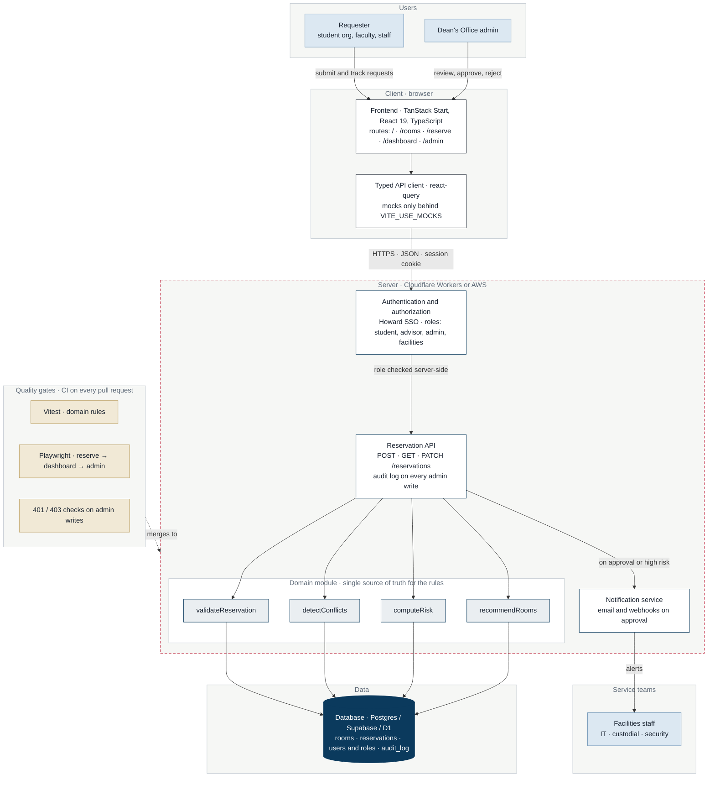

# Backend Builders

**CEA Event Space Reservation System**

## 🚀 Overview

Our team, The Backend Builders, built a web-based event reservation and decision support system designed for the College of Engineering and Architecture at Howard University.

The platform transforms a manual, form-based reservation process into an intelligent system that validates requests in real time, assists users during event planning, and helps administrators efficiently manage approvals and campus resources.

## 🔗 Preview

Group 2 project link:  
https://id-preview--4f0e361e-9ccb-4f09-b180-76f38ef45d33.lovable.app/

## ❗ Problem

The existing reservation process relies on manual review and coordination across multiple departments. This leads to:

- Delays in event approvals
- Inefficient communication between offices
- Risk of missing safety or policy requirements
- Poor visibility into space usage and demand

The system collects information but does not assist in decision making.

## 💡 Solution

This project introduces an intelligent reservation system that:

- Validates event details in real time
- Checks room availability before submission
- Recommends rooms based on attendance
- Flags high-risk conditions (large events, outside guests, after hours)
- Notifies IT, custodial, and security services automatically
- Provides an admin dashboard for streamlined approvals

## 🧱 Architecture

**Current state.** The app today is a front-end prototype that runs entirely in the browser. Rooms and requests come from static mock data in `src/lib`, and submissions and approvals are kept in page state, so they are lost on refresh. There is no backend API, database, login, or test suite yet. See the [Project Reset Report](docs/project-reset-report.pdf) for the full assessment.

**Target architecture (planned).** The diagram below is the design the backlog delivers. Users sign in, the frontend talks to a reservation API over HTTPS, every rule runs once in a shared domain module on the server, and approvals persist to the database and fan out to the service teams. The red dashed border around the server is the trust boundary.



The same diagram, plus the as-is layered view of the repository, the today-versus-target comparison, and the ticket dependency graph, is in [`docs/system-map.pdf`](docs/system-map.pdf) (generated from [`docs/system-map.html`](docs/system-map.html)).

## ⚙️ Tech Stack

- React + TypeScript
- Vite
- npm (the only package manager; `package-lock.json` is the lockfile)
- Vitest (unit tests) and Playwright (end-to-end tests)
- Node.js or Flask (backend)
- AWS (planned deployment)
- ESLint + Prettier

## 🧭 Key Features

- Interactive event submission with real-time validation
- Intelligent room recommendation system
- Conflict detection and scheduling validation
- Admin dashboard for approval workflow
- Service coordination (IT, custodial, security)
- Event status tracking (pending, approved, rejected)
- Reservation history and analytics

### Risk detection

One rule set in [`src/domain/risk.ts`](src/domain/risk.ts) (`RISK_POLICY`, `computeRisk`) is used by the reserve form and the admin page. The repository computes risk once when a reservation is stored and saves it on the record, so every page shows the same result. When the reservation API (#13) exists, the server will run the same function at submit time.

| Factor              | Rule                                                                                                                             | Points        |
| ------------------- | -------------------------------------------------------------------------------------------------------------------------------- | ------------- |
| Elevated attendance | 75 to 149 attendees                                                                                                              | 1             |
| Large attendance    | 150 or more attendees                                                                                                            | 2             |
| External guests     | Guests from outside Howard                                                                                                       | 1             |
| After-hours         | Starts before 08:00 or at/after 18:00, or ends before 08:00 or at/after 20:00. Calculated from the times, never entered by hand. | 1             |
| Food service        | Food or catering                                                                                                                 | 1             |
| Security staffing   | External guests with 50 or more attendees                                                                                        | 0 (flag only) |

A score of 0 or 1 is **low**, 2 or 3 is **medium**, and 4 or more is **high**. A high-risk request is marked **requires additional review**. Requests with data that cannot be scored (bad attendance or times) are also marked high and sent to review instead of failing. Every factor carries a reason string, which the admin table displays.

> These thresholds are defaults pending confirmation from the CEA policy owner. They keep the behavior the form and admin page already had. See `DEBT_AND_RISK.md#risk-02` for the fairness concern about these heuristics.

## 📁 Project Structure

```
src/
  assets/       # Static assets
  components/   # Reusable UI components
  hooks/        # Custom React hooks
  lib/          # Business logic and utilities
  routes/       # Application routing
```

## 🛠️ Setup

```bash
git clone git@github.com:joniabeje/backend-builders.git
cd backend-builders
npm ci
```

## ▶️ Run Locally

```bash
npm run dev
```

The app runs at http://localhost:8080.

## 🧪 Testing

| Command                 | What it runs                                                                                             |
| ----------------------- | -------------------------------------------------------------------------------------------------------- |
| `npm test`              | Vitest unit tests (`src/**/*.test.ts`), once                                                             |
| `npm run test:watch`    | Vitest in watch mode                                                                                     |
| `npm run test:coverage` | Unit tests with a coverage report for `src/domain`, `src/data` and `src/lib`; open `coverage/index.html` |
| `npm run test:e2e`      | Playwright smoke tests in `e2e/` against a dev server on port 4173                                       |
| `npm run typecheck`     | `tsc --noEmit`                                                                                           |
| `npm run lint`          | ESLint and Prettier                                                                                      |

Unit tests sit next to the code they test, for example `src/domain/risk.test.ts`. They cover the framework-free rules in `src/domain` and the repository in `src/data`. Vitest reads `vitest.config.ts`, not the Lovable `vite.config.ts`, so the tests don't load the app's build plugins.

Before your first e2e run, download the browser once with `npx playwright install chromium`. Playwright starts its own dev server on port 4173, so a dev server you already have running on 8080 won't get in the way.

**CI** (`.github/workflows/ci.yml`) runs on every pull request and on pushes to `main`. It has two jobs:

- **verify:** lint, typecheck, unit tests with coverage, then build.
- **e2e:** the Playwright smoke tests.

If any step fails, the PR check fails. The coverage report is attached to each run, and the Playwright report and traces are attached when e2e fails.

## 👥 Team

- Jonathan Abeje
- Nathnael Bereketab
- Giliad Dawite
- Peter Collins

## 🚧 Status

In development. Core system architecture and frontend structure are in place. Backend integration and advanced features are actively being built.

## 🔮 Future Work

- Authentication system
- Full backend API integration
- Database implementation
- AI-assisted scheduling optimization
- Deployment to AWS
