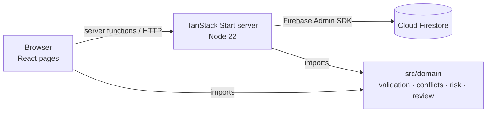

# Architecture decisions

Decisions for the persistent backend (#13) and sign-in (#14, #59), agreed by the team on 2026-11-17. Each record says what we chose, what we turned down, and what it costs us.

## Current shape

- Pages read and write through the `ReservationRepository` interface (`src/data/`). Today that is the in-memory repository; the API repository replaces it in #57.
- Every business rule lives once in `src/domain/` and runs in both places: in the browser for live feedback, and on the server as the check that counts.
- The browser never talks to Firestore directly. Only the server does, with the Admin SDK.

## ADR-1: Cloud Firestore for data

**Decision.** Store rooms, reservations, their history, users, sessions and notifications in Cloud Firestore, accessed only from the server through the Firebase Admin SDK.

**Why.**

- Managed, nothing to run or patch, and a free tier that covers a class project.
- Transactions let `POST /reservations` check for a double booking and save in one atomic step (#65).
- The Firebase Emulator runs the same database locally and in CI with no account or credentials.

**Turned down.**

- _Cloudflare D1 (SQLite)_, suggested in #13: a good fit for the old Cloudflare setup, but the team chose Firebase.
- _A separate Express or Flask service_: a second codebase and deploy for no gain, since TanStack Start already runs server code.

**Costs.**

- No SQL schema or migrations. #54 becomes typed collections, converters and indexes instead.
- Queries are limited to what Firestore indexes allow. The date-range and per-room queries (#50, #51) need composite indexes in `firestore.indexes.json`.
- Security rules deny all browser access. If a page ever needs live updates straight from Firestore, the rules must be opened deliberately for that collection.

## ADR-2: Server code runs on Node, inside TanStack Start

**Decision.** API endpoints are TanStack Start server functions and server routes. They run on Node 22: `vite dev` locally and in CI, and a Node build in production.

**Why.** The Admin SDK needs Node APIs. Outside a Lovable sandbox, `@lovable.dev/vite-tanstack-config` already builds without the Cloudflare bundler ("No Lovable context detected — skipping nitro deploy plugin"), so nothing has to change for development or CI.

**Production.** Build with Nitro's `node-server` preset (`NITRO_PRESET=node-server`, which the Lovable config reads) and deploy the container to Firebase App Hosting or Cloud Run. App Hosting does not officially list TanStack Start, so Cloud Run is the fallback. Deployment is a follow-up ticket; nothing in #13 or #14 requires it.

**Costs.** The Lovable preview still builds for Cloudflare Workers, where the Admin SDK cannot run. Once #57 lands, the preview has to run with `VITE_USE_MOCKS=true`, which keeps the in-memory repository.

## ADR-3: Our own email and password sign-in (#59)

**Decision.** Accounts live in a `users` collection with a `role` (`student`, `advisor`, `admin`, `facilities`). Passwords are hashed with scrypt (Node's built-in `crypto`, per-user random salt). Signing in creates a `sessions` document with an expiry, and the browser receives its id in an `HttpOnly`, `Secure`, `SameSite=Lax` cookie that page scripts cannot read. Every protected server endpoint loads the session and checks the role (401 when signed out, 403 for the wrong role). One account per role is seeded for development and demos (#60).

**Why.** No external sign-up or console setup, works the same in the emulator and in CI, and the team owns the whole flow end to end for the course.

**Turned down.**

- _Firebase Auth_ with roles as custom claims: less code and a hosted login page, and the natural choice with Firestore. The team preferred to own the sign-in flow for now.
- _Supabase Auth or Auth0_, suggested in #14: a second vendor next to Firebase.

**Costs.** We are responsible for password storage, session expiry and sign-out, and for rate-limiting sign-in attempts. There is no password reset or email verification yet.

**Later.** Howard SSO replaces the password form when the university provides it. Sessions and role checks stay the same; only how a user proves who they are changes.

## Local development

- Java 21 or newer is required for the Firebase Emulator (`winget install Microsoft.OpenJDK.21` on Windows).
- `npm run emulators` starts Firestore locally under the placeholder project `demo-cea-reserve`. `demo-` projects never reach Google's servers and need no credentials.
- With the emulator running, `npm run seed` loads the room catalog and the demo reservations with their history. It is safe to run again. Against a real project (`FIREBASE_PROJECT_ID`) it refuses demo data and needs `--rooms-only`.
- `npm run test:integration` starts the emulator, runs the integration tests against it, and stops it.
- The real Firebase project id is only needed for deployment.

## Data model

| Collection                  | Holds                                                                                                      | Written by                       |
| --------------------------- | ---------------------------------------------------------------------------------------------------------- | -------------------------------- |
| `rooms`                     | id, name, building, capacity, features                                                                     | seed script (#58)                |
| `reservations`              | request fields, `requesterId`, status, risk (`level`, `score`, `requiresReview`, `factors`), `submittedAt` | `POST` and `PATCH /reservations` |
| `reservations/{id}/history` | one document per status change: from, to, actor, feedback, at                                              | `PATCH /reservations/:id` (#85)  |
| `users`                     | email, name, role, password hash and salt                                                                  | seed script (#60)                |
| `sessions`                  | userId, role, expiresAt                                                                                    | sign-in and sign-out             |
| `notifications`             | id `{reservationId}_{service}`, so each request notifies each service at most once                         | approval (#40)                   |

Reservations are never deleted, including rejected ones, so history and analytics stay complete (#50).

**Indexes** (`firestore.indexes.json`). Firestore indexes every single field automatically, which covers the double-booking check (`room` and `date` equality), the date-range query on `date` (#50) and ordering history by `at`. The one composite index is `requesterId` + `submittedAt` descending, for "my requests, newest first" on `/dashboard` (#36). Add an index here in the same PR as any new query that filters on one field and sorts on another.
