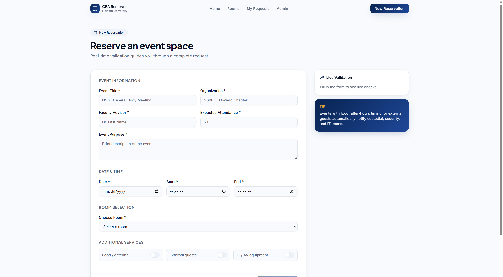
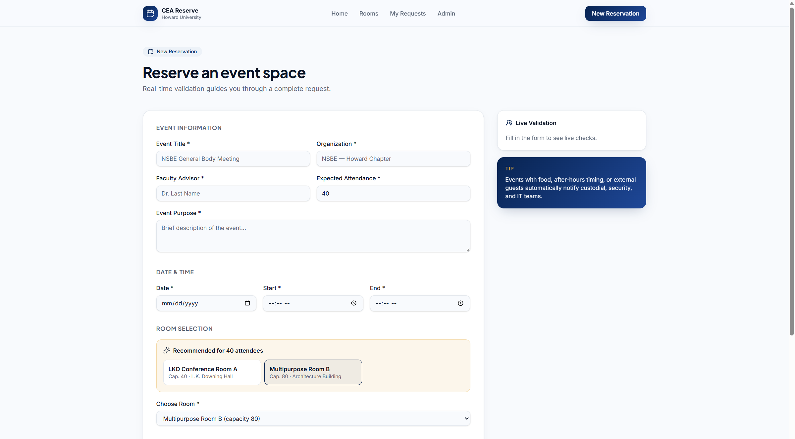
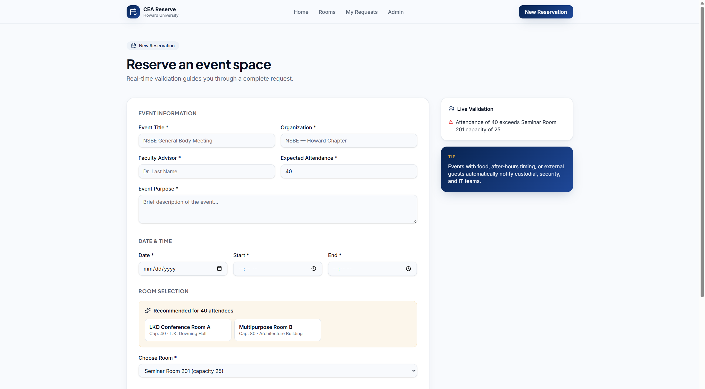
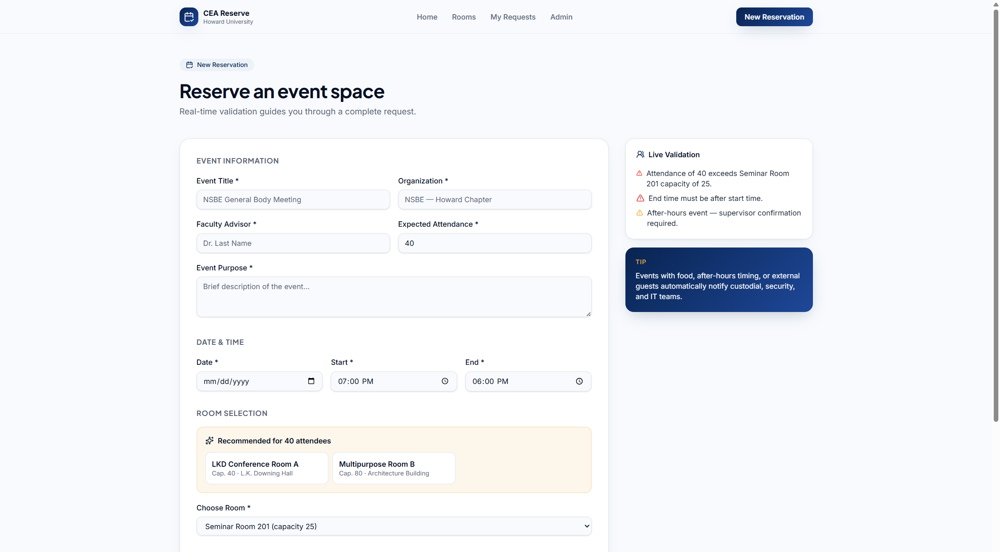
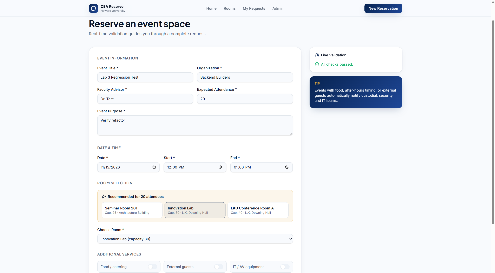
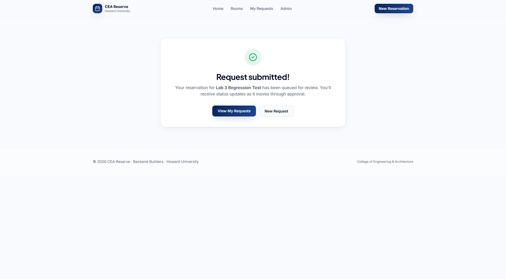
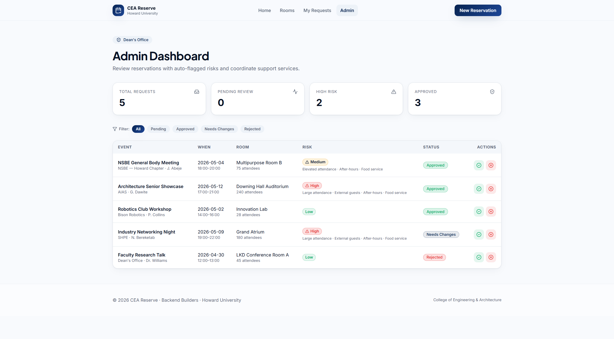
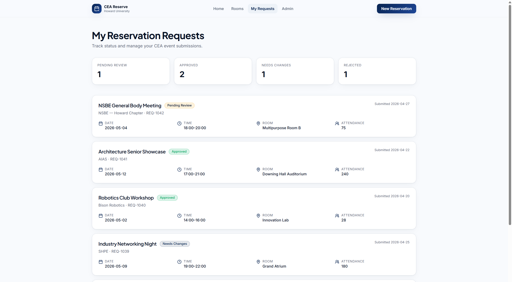

# refactor(reserve): separate form state, form controls and UI panels from the reserve route

**Lab 3 – AI-Assisted Refactoring with Cursor** · Backend Builders · CEA Event Space Reservation System
Branch: `lab3/extract-reservation-domain` → `main`

## 1. Refactor Rationale

### Problem

After TD-03 ([#16](https://github.com/joniabeje/backend-builders/pull/16)) moved the validation
rules into `src/domain/reservation-validation.ts`, `src/routes/reserve.tsx` was still the largest
file in the app (359 lines). One component was doing five unrelated jobs:

| Concern | Where it lived |
| --- | --- |
| Form state machine (fields, submitted flag, update, submit guard, reset) | `useState` ×2, `update()`, inline `onSubmit` and `onClick` handlers |
| Room recommendation wiring | `useMemo(() => recommendRooms(...))` |
| Generic form primitives (`Section`, `Field`, `Toggle`, `inputCls`) | private functions at the bottom of the route file |
| Success screen, recommendation cards, live-validation panel | ~80 lines of inline JSX |
| Page layout and input bindings | the actual job of a route |

### Principles applied

- **Single Responsibility / Separation of Concerns** – the route now only composes the page.
  State transitions, reusable controls and self-contained panels each live in their own module.
- **Abstraction** – the page talks to `useReservationForm()` (`form`, `validation`,
  `recommendations`, `update`, `submit`, `reset`) and does not know how state is stored.
- **Testability through pure functions** – form transitions are a framework-free reducer in
  `src/domain/`, following the convention the team set for `reservation-validation.ts`. The rule
  "an invalid form can never become submitted" used to exist only as an inline `if (canSubmit)` in
  JSX; it is now enforced by the reducer and covered by unit tests.
- **DRY / reuse** – `FormSection`, `FormField`, `ToggleField` and `inputClassName` can be used by
  future forms (login, room admin) instead of being copied.

### Structure

**Before**

- `src/routes/reserve.tsx` – 359 lines: state, handlers, 3 panels, 3 form primitives, page

**After**

| File | Lines | Responsibility |
| --- | --- | --- |
| `src/routes/reserve.tsx` | 215 | Page composition and input bindings only |
| `src/hooks/use-reservation-form.ts` | 35 | React adapter: reducer + validation + recommendations |
| `src/domain/reservation-form.ts` | 63 | Pure state transitions (`update` / `submit` / `reset`) |
| `src/domain/reservation-form.test.ts` | 92 | 9 unit tests for the reducer |
| `src/components/form-controls.tsx` | 60 | Reusable `FormSection`, `FormField`, `ToggleField`, `inputClassName` |
| `src/components/reserve/ReservationSuccess.tsx` | 37 | "Request submitted!" screen |
| `src/components/reserve/RoomRecommendations.tsx` | 39 | Recommended room cards |
| `src/components/reserve/ValidationPanel.tsx` | 39 | Live validation sidebar |

Dependency direction: `routes → hooks → domain`, `routes → components`. Nothing in `domain/`
imports React, so these rules can move to a server later (TD-01).

### Commits

1. `refactor(components): extract reusable form controls from reserve route`
2. `refactor(domain): model reservation form state as a pure reducer`
3. `refactor(reserve): move form state into useReservationForm hook`
4. `refactor(reserve): split success screen, recommendations and validation panel into components`
5. `docs(lab3): add refactor report and verification evidence`

Each commit builds and passes lint and type-check on its own.

## 2. AI Usage Summary (VIBE log)

**Tool:** Cursor Agent (chat, Agent mode).

### Prompts

| # | Role | Prompt (verbatim) | What the AI did |
| --- | --- | --- | --- |
| 1 | Planner | *(pasted the full Lab 3 assignment text)* "…im working on this lab now lets make a stpe by step plan how to complete it fully" | Read `DEBT_AND_RISK.md`, `reserve.tsx` and `mock-requests.ts` and proposed extracting the inline validation rules (TD-03) into a domain module plus a hook. |
| 2 | Coder | "step 1 lets make it quick" / "is the baseline needed" | Explained that git history already preserves the "before" state, so a separate baseline run was optional. |
| 3 | Coder | "we have to commit all the assingmetnse requirmeents" | Branched from the latest `origin/main`, re-audited, implemented the refactor in four commits, ran build/tests/lint, drove a browser regression check, and drafted this report. |

### Where the AI's first plan was wrong and was corrected

- **Stale codebase.** The first plan (prompt 1) was based on a local branch that was behind
  `main`. After fetching, the AI found that a teammate had already extracted the validation rules
  in [#16](https://github.com/joniabeje/backend-builders/pull/16) and added a repository layer in
  [#19](https://github.com/joniabeje/backend-builders/pull/19). Doing the original plan would have
  duplicated merged work. The candidate was changed to the remaining smell in the same file
  (state machine, form primitives and panels).
- **Lint noise vs. real issues.** ESLint reported hundreds of `Delete ␍` errors. These were
  verified to be pre-existing on untouched files (`core.autocrlf=true` on Windows) and not caused
  by the refactor. Lint was re-run with `endOfLine: auto` to isolate real problems, which found two
  mixed-line-ending lines introduced by a scripted edit; those were fixed.
- **Type cast.** The first version of the hook cast the dispatched action with
  `Parameters<typeof dispatch>[0]`. It was replaced with the named `ReservationFormAction` type
  and a comment explaining why TypeScript needs the cast (generic key vs. mapped union).
- **Import style.** The reducer first imported `./reservation-validation.ts` with an extension.
  The test resolver and existing modules use extensionless imports, so it was changed to match.

### Human verification and modifications

> **TODO (author):** Fill in from your own review before submitting. The rubric rewards concrete
> evidence that a human checked the AI's work. For example:
>
> - What you read in the diff (`git diff a9bc678..HEAD`) and anything you questioned.
> - Anything you changed by hand (naming, a comment, a prop name, a test case you added).
> - That you clicked through `/reserve`, `/admin` and `/dashboard` yourself.

## 3. Verification

This is a pure refactor, so the goal is **feature parity**: no visible change in markup, classes,
messages or behavior.

### Automated

- `npm run build` – client (1927 modules) and SSR (82 modules) bundles built with exit code 0.
- `npx tsc --noEmit` – exit code 0.
- `npm test` – **39 / 39 passing** (30 existing + 9 new reducer tests). Full output:
  [`test-output.log`](./test-output.log).
- ESLint (Prettier with `endOfLine: auto`) – 0 problems in all changed files.

### Manual regression checklist

All checks were run against `npm run dev` after the refactor:

- [x] Empty form: panel says "Fill in the form to see live checks.", Submit is disabled.
  
- [x] Attendance 40 shows "Recommended for 40 attendees"; clicking a card sets **Choose Room**.
  
- [x] 40 attendees in Seminar Room 201 shows "Attendance of 40 exceeds Seminar Room 201 capacity
  of 25." 
- [x] Start 19:00 / end 18:00 shows "End time must be after start time." and the after-hours
  warning. 
- [x] Food plus external guests at 60 attendees shows the food-service and security warnings.
- [x] Valid form shows "All checks passed." and enables Submit.
  
- [x] Submit shows "Request submitted!" with the event title.
  
- [x] "New Request" clears every field and disables Submit again.
- [x] `/admin` still renders risk badges and stats; Approve moves a request from Pending to
  Approved. 
- [x] `/dashboard` still renders all requests and status counts.
  
- [x] No browser console errors on `/reserve`, `/admin` or `/dashboard`.

### Known limitations (unchanged by this PR)

- Submitting a reservation still does not persist it. `/reserve` was never wired to the
  reservation repository, so the request does not appear on `/admin` or `/dashboard`. This is
  pre-existing TD-01 scope. `useReservationForm().submit` is now the single place to add that call.
- Admin approvals live in memory and reset on a full page reload (by design of the in-memory
  repository from #19).
