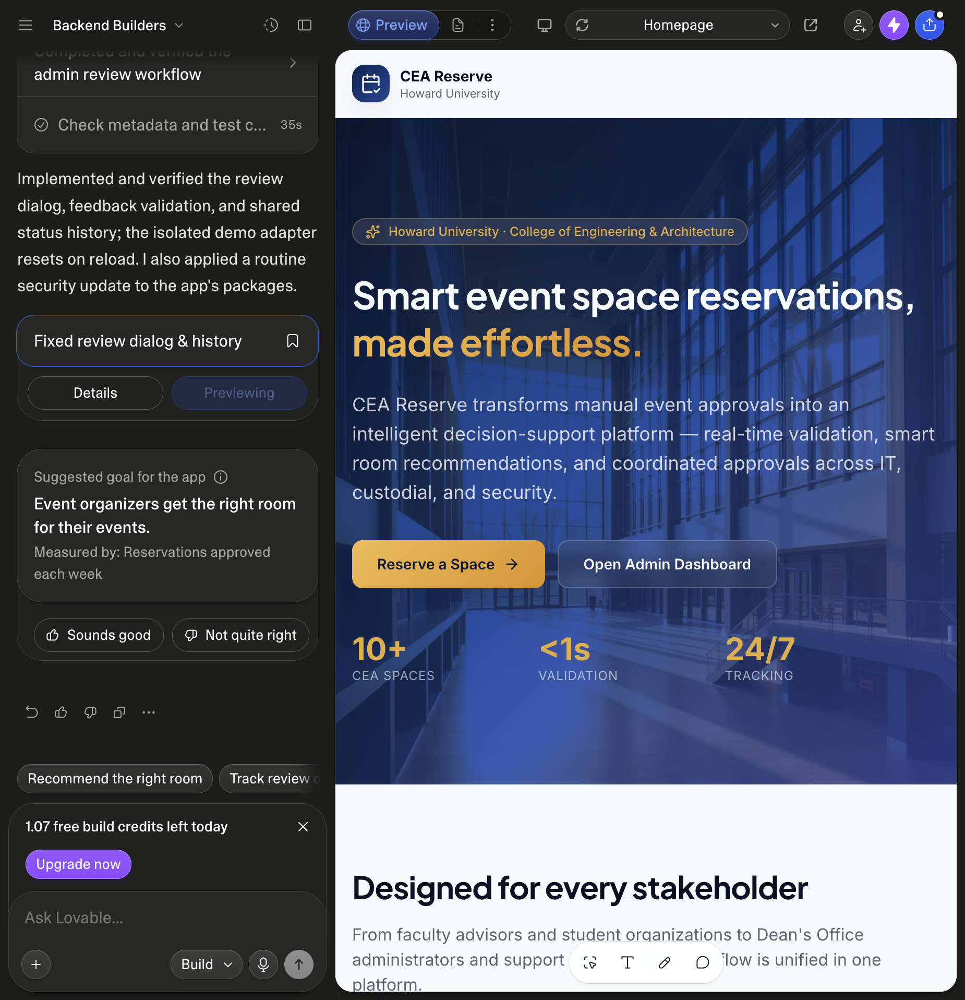
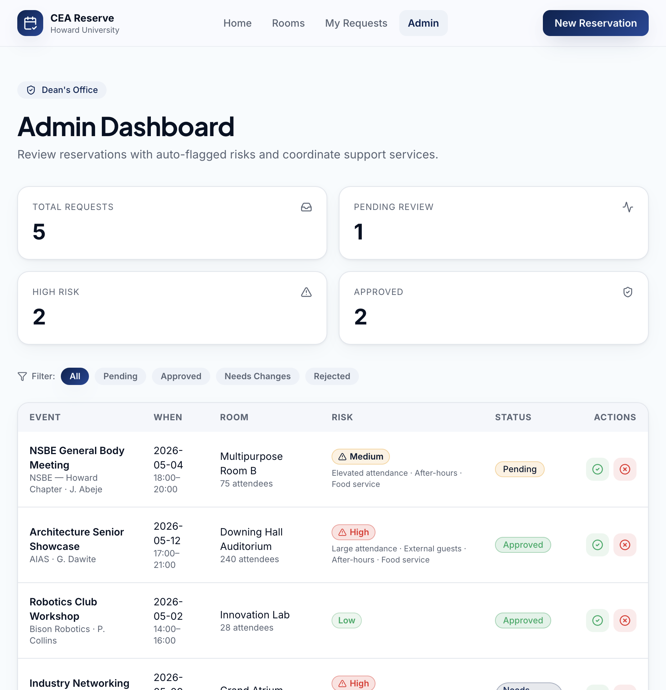
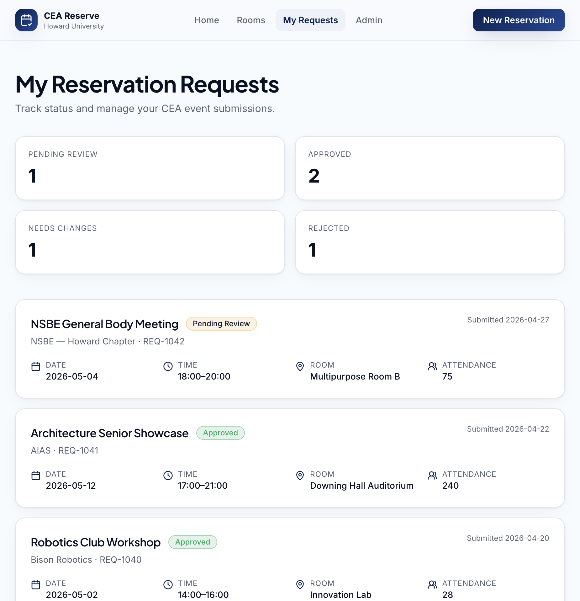
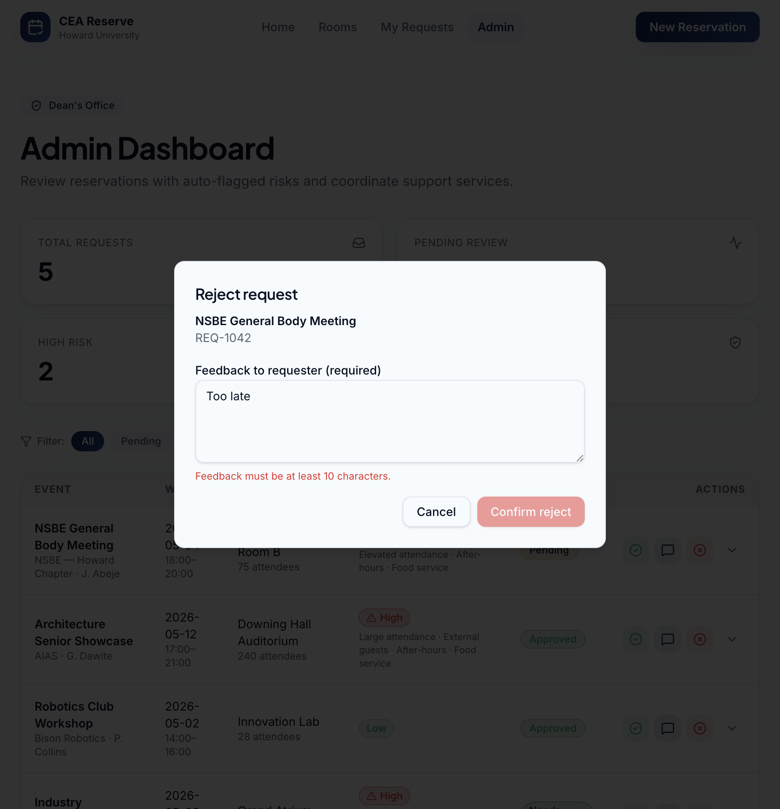
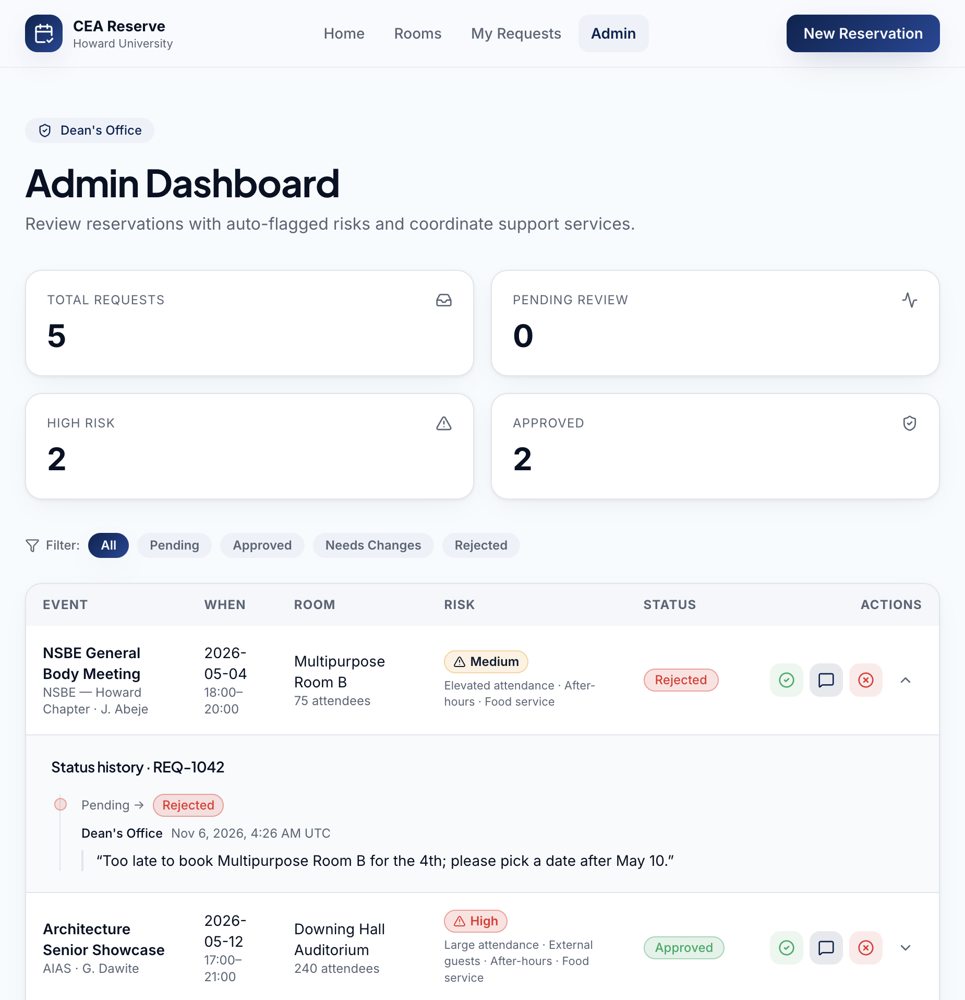
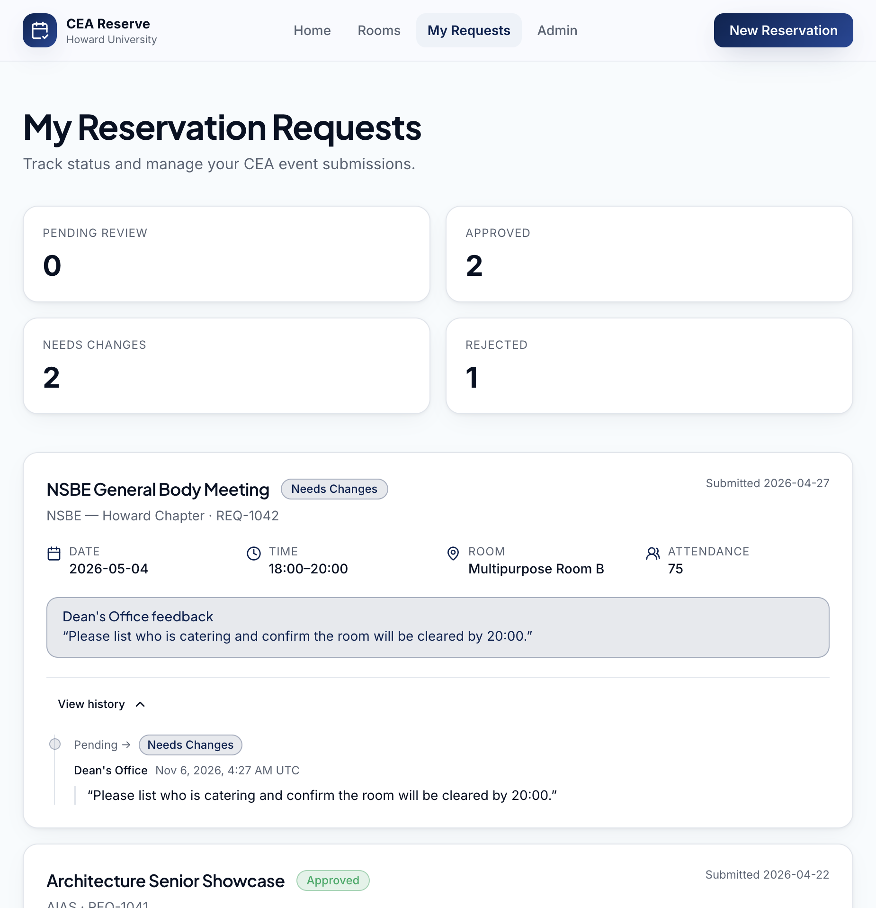

# feat(admin): review dialog with feedback and status history (#7)

**Lab 6 – Lovable.dev Feature Extension** · Backend Builders · CEA Event Space Reservation System
Branch: `lab6/approve-reject-feedback` → `main` · Backlog issue: [#7 Approve Reject Workflow](https://github.com/joniabeje/backend-builders/issues/7)
Lovable project: [Backend Builders on Lovable](https://lovable.dev/projects/4f0e361e-9ccb-4f09-b180-76f38ef45d33)

## 1. Why this feature

Issue #7 is P0 for the MVP. Before this change, an admin could approve or reject with one click.
Nothing asked why, nothing was recorded, and the requester's `/dashboard` only showed a coloured
badge, so a "Rejected" or "Needs Changes" request gave the student nothing to act on.

It suits Lovable because most of the work is UI: a confirmation dialog with a validated textarea, a
timeline, and a callout. These are self-contained shadcn components that Lovable generates well. The
risky part is data flow, and that was kept for a human to integrate into our existing repository
layer.

## 2. What Lovable generated

Prompt sent to Lovable (a single build message, verbatim):

> Extend the admin Approve/Reject workflow (backlog issue #7). Keep the change small and
> self-contained so it can be merged into our main repo, which has a different data layer.
> (1) Create src/components/admin/ReviewDecisionDialog.tsx: a shadcn AlertDialog that opens when the
> admin clicks Approve, Request changes, or Reject on an /admin row. It shows the event title and
> request id, the chosen decision, and a Textarea for feedback to the requester. Feedback is
> required for Reject and Request changes (at least 10 characters, inline error, confirm button
> disabled until valid) and optional for Approve. Props only, no data access inside: open,
> onOpenChange, request ({ id, title }), decision ("approved" | "needs-changes" | "rejected"),
> onConfirm(feedback: string), pending?: boolean. (2) Create src/components/StatusTimeline.tsx: a
> vertical timeline of status changes, each entry { from, to, actor, feedback?, at } where at is an
> ISO timestamp; use the same status colors as the existing badges, show a readable date, and quote
> the feedback. Props only. (3) On /admin add a third 'Request changes' action next to Approve and
> Reject; all three open the dialog, and confirming updates the status and appends a history entry
> with actor "Dean's Office". (4) Let each /admin row expand to show its StatusTimeline. (5) On
> /dashboard, for rejected or needs-changes requests, show the latest admin feedback in a
> highlighted callout on the card, plus a 'View history' collapsible with the StatusTimeline. Reuse
> existing design tokens and shadcn components. Do not change the reservation form, rooms page,
> landing page, or styles.css.

The Lovable project is an older snapshot of this app: it has no `src/domain`, no repository and no
react-query. It also had no GitHub sync, so the generated files were exported from Lovable's
read-only Code view and merged here by hand. The table below covers every file Lovable created or
changed, and what happened to each one.

| Lovable file | What Lovable did | What this PR does with it |
| --- | --- | --- |
| `src/components/admin/ReviewDecisionDialog.tsx` | New props-only AlertDialog with feedback textarea, 10-char rule, inline error, pending state | **Kept** (same markup, a11y and behaviour). Imports now point at `@/domain/review-decision`; the 10 is a named constant; fixed the title "Request changes request" → "Request changes" |
| `src/components/StatusTimeline.tsx` | New props-only timeline | **Kept**. The pill now reuses our `StatusBadge`, and the colours come from the shared `status-styles.ts` instead of a second copy |
| `src/lib/review-decisions.ts` | Feedback rule, `applyReviewDecision`, `latestAdminFeedback`, plus a duplicate copy of the status labels and colours | **Rewritten** as `src/domain/review-decision.ts`. Same rules, but pure domain code typed against `@/domain/reservation`. The actor and time are passed in, not hard-coded, and it throws a named `ReviewFeedbackError`. The duplicate labels and colours were dropped |
| `src/lib/review-decisions.test.ts` | 3 node:test cases | **Ported** into `src/domain/review-decision.test.ts` and extended to 9 |
| `src/lib/demo-review-store.ts` | Module-level `useSyncExternalStore` store seeded from `MOCK_REQUESTS` | **Not merged.** It would bypass `ReservationRepository`, re-couple the routes to mock data (TD-01), and share state between SSR requests. Our repository and hooks already do this job |
| `src/routes/admin.tsx` | Third action, dialog, expandable history row; read data from the demo store | **Re-applied by hand** to our `admin.tsx` through `useReviewReservation()`. Kept the existing loading and error rows, room display names and `riskScore`. Lovable's unrelated `og:` meta tags, the request-id line and the switch of the filter buttons to `<Button>` were left out |
| `src/routes/dashboard.tsx` | Feedback `Alert` and "View history" `Collapsible`; read the demo store | **Re-applied by hand** through `useReservations()`. Kept our `StatusBadge`, `countByStatus` and loading and error states |
| `package.json` / lockfile | "Routine security update": pinned `@tanstack/react-router` 1.170.41, `react-start` 1.168.60, `router-plugin` 1.168.42, `@lovable.dev/vite-tanstack-config` 2.26.5, and added `nitro` `3.0.260603-beta` | **Not merged.** This was not requested and is a framework upgrade plus a beta server runtime. Our lockfile is unchanged. If the team wants the upgrade, it belongs in its own PR with its own testing |
| `AGENTS.md`, `roadmap.md`, `.lovable/north-star` | Lovable's own project notes | **Not merged** (tool metadata, not product code) |

## 3. Before / After

### Before

- `/admin` had two icon buttons. Clicking Reject changed the badge instantly: no confirmation, no
  reason, no record of who or when.
- `ReservationRepository.updateStatus(id, status)` overwrote the status. `EventRequest` had no history.
- `/dashboard` showed a badge only, so "Rejected" gave the requester no reason.

| `/admin` before | `/dashboard` before |
| --- | --- |
|  |  |

### After

- `/admin` has **Approve**, **Request changes** and **Reject**. Each opens
  `ReviewDecisionDialog`, which shows the event title and id. Feedback is optional for Approve and
  required (at least 10 trimmed characters) for the other two. Confirm stays disabled and an inline
  `role="alert"` error appears until the feedback is valid. Each row has a chevron that expands its
  `StatusTimeline`.
- The data layer records decisions. `ReservationRepository.review(id, { decision, feedback })`
  replaces `updateStatus`. The in-memory implementation validates the decision, enforces the feedback
  rule (the UI is not the only guard), and appends
  `{ from, to, actor, feedback?, at }` to `EventRequest.history`. The repository supplies the actor
  and the clock, so it can be swapped for an API that takes them from the session (#13, #14).
- `useReviewReservation()` keeps the existing optimistic-update, rollback and toast behaviour. The
  badge flips immediately, the history entry comes from the repository's response, and a failure
  restores the list and keeps the dialog open.
- `/dashboard` shows the latest reviewer feedback in a callout coloured like the status, but only
  for Rejected and Needs Changes, the states where the requester has something to fix. Every card
  has a "View history" collapsible.
- The seed data now carries history consistent with each status. For example, the Needs Changes
  request explains that 180 guests exceeds the Grand Atrium's capacity of 150.

| Reject dialog validation | `/admin` history after a decision |
| --- | --- |
|  |  |

### Files

| File | Change |
| --- | --- |
| `src/domain/reservation.ts` | `StatusChange` type; `EventRequest.history` (oldest first) |
| `src/domain/review-decision.ts` (+ test) | New: decisions, labels, feedback rule, `applyReviewDecision`, `latestFeedback` |
| `src/data/reservation-repository.ts` | `updateStatus` → `review(id, input)`; documented error contract |
| `src/data/in-memory-reservation-repository.ts` (+ test) | Records history; injectable `reviewer` and `now`; deep-copies history on read and write |
| `src/hooks/use-reservations.ts` | `useUpdateReservationStatus` → `useReviewReservation` |
| `src/lib/mock-requests.ts` | Seed history |
| `src/components/status-styles.ts` | New: status colours shared by badge, timeline and callout (moved out of `StatusBadge.tsx`) |
| `src/components/admin/ReviewDecisionDialog.tsx`, `src/components/StatusTimeline.tsx` | From Lovable (see table above) |
| `src/routes/admin.tsx`, `src/routes/dashboard.tsx` | Wired to the hooks |

Architecture is unchanged. The dependency direction is still `routes → hooks → repository → domain`,
`domain/` imports no React, routes never import mock data, and `src/router.tsx` (the composition
root) did not need to change.

## 4. How a human verified it

Automated checks (run locally on this branch):

| Check | Result |
| --- | --- |
| `npx tsc --noEmit` | Pass |
| `npm test` | 90/90 pass (79 on `main`): 9 new domain tests, repository suite rewritten for `review` and grown from 7 to 9 |
| `npm run build` | Pass |
| `npx eslint` on every changed or new file | Clean |
| `npm run lint` (whole repo) | The same 20 Prettier errors as `main`, all in files this PR does not touch (`index.tsx`, `__root.tsx`, `SiteNav`, `SiteFooter`, a few `ui/*`) |

Manual walkthrough in the browser (`npm run dev`):

- [x] `/admin`: Reject on REQ-1042 opens "Reject request" with the title and id. Confirm is disabled.
- [x] Typing "Too late" (8 characters) shows "Feedback must be at least 10 characters." and Confirm
      stays disabled. With a full sentence, Confirm enables.
- [x] Confirming closes the dialog, the badge becomes Rejected, and Pending Review drops from 1 to 0.
      The chevron shows "Pending → Rejected · Dean's Office · Nov 6, 2026, 4:26 AM UTC" with the quoted feedback.
- [x] Request changes on the same request, then navigating to **My Requests**: the card shows Needs
      Changes, the counts update, the "Dean's Office feedback" callout shows the new text, and
      "View history" lists the entry.
- [x] Approve on REQ-1039 (seeded as Needs Changes): the label reads "(optional)", Confirm is enabled
      with an empty textarea, and the history appends "Needs Changes → Approved" under the seeded
      entry, with no empty quote.
- [x] Cancel and Esc close the dialog without changing anything.
- [x] Regression check on `/reserve`: picking 2026-05-04 18:00–20:00 still removes Multipurpose Room B
      ("5 of 6 rooms are free"). Availability still reads the shared repository.
- [x] `/` and `/rooms` were not touched and render as before.

## 5. Known limits and follow-ups

- **Persistence:** decisions live in the in-memory repository, so a full page reload resets them.
  "Survives a page refresh" in #7 needs #13 (persistent API). Only
  `InMemoryReservationRepository` has to be replaced.
- **Who can review:** the actor is the fixed reviewer name `"Dean's Office"`, and anyone who opens
  `/admin` can make decisions. The 403 for non-admins and a real `actorId` need #14 (auth).
- **Feedback on Reject:** #7 says "optional feedback for rejected requests". This PR makes it
  required (at least 10 characters) for Reject and Request changes, because a rejection with no
  reason was the original problem. If the team disagrees, the rule is the one-line
  `isFeedbackRequired` in `src/domain/review-decision.ts`.
- The #7 integration test "create, approve, list" is covered at the repository level for
  review → list. There is no create endpoint yet (#13).

## 6. AI usage log

| Step | Tool | Human decision |
| --- | --- | --- |
| Pick the feature and write a scoped, props-only prompt | Cursor agent | Chose #7. Constrained Lovable to props-only components so they could be dropped into our data layer |
| Generate the dialog, timeline, review rules and route wiring | Lovable (1 build message) | Reviewed every generated file (section 2) |
| Integrate into the repository, hook and domain layers; port and extend tests | Cursor agent | Rejected the demo store, the package bump and Lovable's docs; moved the rules into `domain/` |
| Verify | Cursor agent + browser | Ran the walkthrough above and fixed the dialog title Lovable got wrong |
